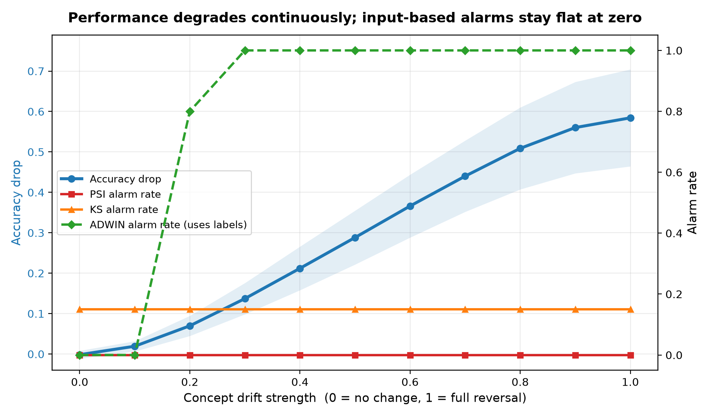
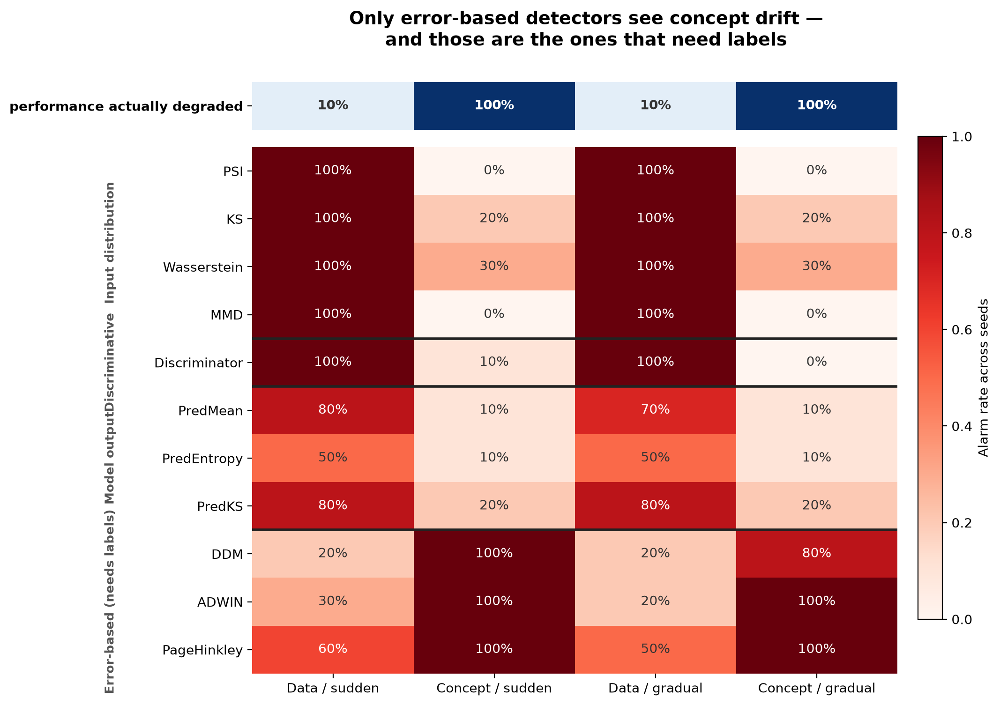
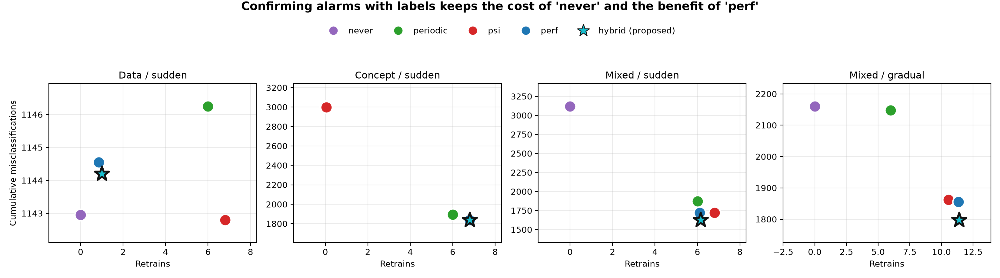
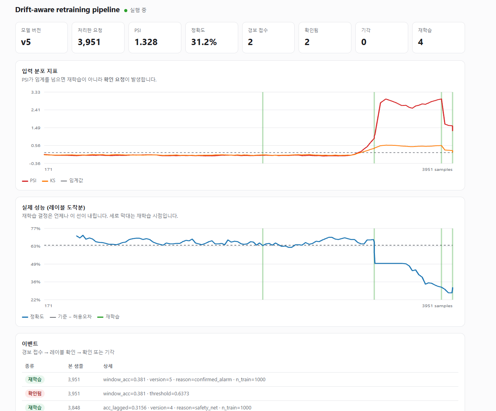

# drift-retrain-policy

Measuring how well drift detection metrics predict actual model performance
degradation, and when to retrain.

입력 분포 변화를 재는 지표(PSI, KS 등)는 모델 성능이 실제로 떨어졌는지를
알려주지 않는다. 이 저장소는 그 괴리를 정량화하고, 입력 지표를 재학습
트리거가 아니라 **레이블 확보 우선순위 신호**로 쓰는 정책을 제안한다.

---

## 핵심 결과

> 입력 기반 지표는 재학습 트리거로는 실패하지만, 레이블 확보 우선순위를
> 정하는 신호로는 유효하다. 신호의 문제가 아니라 그것을 어떤 결정에
> 쓰느냐의 문제였다.

| 실험                   | 결과                                                        |
| ---------------------- | ----------------------------------------------------------- |
| 경보 vs 실제 성능 저하 | 80회 중 동시 발생 **0회**                                   |
| 임계값 스윕 (0.01–4.0) | 총 오판율이 **47.5% 아래로 내려가지 않음**                  |
| 탐지기 11종 4계열      | 레이블 없는 8종 모두 컨셉 드리프트를 **30% 이하로만 포착**  |
| 운영 손실              | PSI 재학습 효과가 **0과 통계적으로 구분되지 않음** (p=0.32) |
| 레이블 지연            | 점진적 컨셉 드리프트에서 지연 487에 이점 **절반 소실**      |
| 제안 정책              | 혼합 드리프트에서 **93.6건 개선** (p=1.0e-04)               |



컨셉 드리프트 강도를 0에서 1까지 연속으로 올리면 정확도가 0.58 떨어지는
동안 PSI 경보율은 전 구간에서 0%에 머문다. 가중치 벡터를 회전시켜 크기를
보존했으므로 "신호가 약해져서" 떨어진 것이 아니다.



레이블을 쓰지 않는 8종은 계열을 불문하고 컨셉 드리프트를 대부분 놓친다
(발화율 0–30%, 실제 성능 저하는 100%). 80% 이상 포착한 것은 오차 기반
3종뿐이며, 이들은 모두 정답 레이블을 요구한다. 각 지표의 임계값은 드리프트
없는 스트림에서 경보가 0이 되도록 보정했다.



제안 정책은 어느 시나리오에서도 유의한 열세 없이, 혼합 드리프트에서 이긴다.

## 파이프라인 동작



드리프트 발생 전에는 경보도 재학습도 없다. 발생 후 PSI가 급등하면
재학습이 아니라 확인 요청이 걸리고, 레이블로 확인된 뒤에야 재학습이 실행된다.

---

## 설치

Python 3.10 이상.

```bash
python -m venv .venv
source .venv/bin/activate        # Windows: .venv\Scripts\activate
pip install -r requirements.txt
```

## 실험 재현

스크립트는 논문의 논리 순서대로 쌓인다. 앞의 결과가 다음 실험의 질문을 만든다.

| 순서 | 파일            | 답하는 질문                                                    |
| ---- | --------------- | -------------------------------------------------------------- |
| 0    | `drift.py`      | 데이터 생성기와 지표. 나머지 전부가 이것을 import한다          |
| 1    | `figures.py`    | 경보와 실제 성능 저하가 일치하는가 → **아니오**                |
| 2    | `sweep.py`      | 임계값을 조정하면 되는가 → **아니오**                          |
| 3    | `detectors.py`  | 더 좋은 지표를 쓰면 되는가 → **아니오, 계열 전체의 한계**      |
| 4    | `policy.py`     | 그래서 운영에 어떤 손해인가 → **낭비와 방치가 동시에**         |
| 5    | `delay.py`      | 그럼 오차 기반을 쓰면 되는가 → **레이블이 늦어 가치가 사라짐** |
| 6    | `robustness.py` | 이 결론이 설정값에 의존하는가 → **미탐은 견고, 오탐은 민감**   |
| 7    | `hybrid.py`     | 그럼 어떻게 해야 하는가 → **제안 정책**                        |

```bash
python drift.py && python figures.py && python sweep.py && \
python detectors.py && python policy.py && python delay.py && \
python robustness.py && python hybrid.py
```

전체 약 10분. 결과는 `results/` 에 csv 와 png 로 저장된다 (gitignored).

`service/` 는 7번의 제안 정책을 실제 서비스로 구현한 것이다.

### 실험 설계 메모

합성 데이터의 라벨은 `p = σ(xᵀw)` 에서 베르누이 샘플링으로 생성되므로
되돌릴 수 없는 노이즈가 존재한다. 시드별 베이즈 최적 정확도는 0.655–0.851이고,
학습된 모델의 정확도는 이와 ±0.01 이내로 일치한다. 따라서 관측되는 성능
저하는 모델의 학습 부족이 아니라 드리프트에 의한 것이다.

## 파이프라인 실행

제안 정책을 실제 서비스 형태로 구현한 것. 예측 API, 지연 레이블 수집,
드리프트 감시, 자동 재학습, 대시보드가 한 프로세스로 돈다.

```bash
# 터미널 1 — 서비스
uvicorn service.api:app --reload

# 터미널 2 — 트래픽 시뮬레이터
python -m service.simulator --drift mixed --rate 250
```

두 명령 모두 저장소 루트에서 실행한다.
브라우저에서 <http://127.0.0.1:8000> 을 열면 대시보드가 보인다.

Docker:

```bash
docker compose up --build                    # 서비스만
docker compose --profile demo up --build     # 시뮬레이터까지
```

### API

| 엔드포인트             | 설명                       |
| ---------------------- | -------------------------- |
| `POST /bootstrap`      | 초기 모델 학습·배포        |
| `POST /predict`        | 예측. `pred_id` 를 반환    |
| `POST /label`          | 지연 도착한 정답           |
| `GET /labeling-policy` | 레이블을 먼저 확보할 구간  |
| `GET /status`          | 현재 지표·모델 버전·이벤트 |
| `GET /history`         | 대시보드용 시계열          |

### 제안 정책 동작

```
PSI 임계 초과
   └─ 재학습하지 않고 '확인 대기'에 올림
      └─ 해당 구간 레이블 우선 확보 요청 (지연 1/4)
         ├─ 실제 저하 확인  → 재학습 (우선 확보분을 학습에도 사용)
         └─ 저하 없음       → 기각, 기준 구간만 갱신
PSI 침묵
   └─ 통상 지연의 성능 감시가 안전망으로 동작
```

재학습 결정은 항상 레이블이 내린다. 입력 지표는 레이블 예산을 어디에
먼저 쓸지만 정한다.

성능 저하 판정선은 드리프트 없는 워밍업 구간에서 변동폭 σ를 측정해
`base − max(perf_tol, 2σ)` 로 잡는다. 초기 구현에서는 고정 허용오차
(`perf_tol = 0.05`)만 썼고, 그 결과 드리프트가 없는 구간에서도 재학습이
11회 발생했다. 윈도우 간 자연 변동이 허용오차를 넘었기 때문이다. σ를
반영하도록 바꾸자 0회가 되었다. 탐지기 임계값을 무드리프트 스트림으로
보정한 것과 같은 원리이며, 오프라인 시뮬레이션에서는 드러나지 않고 실제
스트리밍 구현에서만 나타난 문제다.

---

## 구조

```
drift.py           합성 데이터 생성기 (data / concept / mixed), PSI·KS
├─ figures.py      대표 그림
├─ sweep.py        다중 시드 + 임계값 스윕
├─ detectors.py    탐지기 4계열 11종, 무드리프트 기준 임계값 보정
├─ policy.py       재학습 정책 시뮬레이터
│   ├─ delay.py        레이블 지연 민감도
│   └─ hybrid.py       제안 정책 평가 + 혼합 드리프트
├─ robustness.py   민감도 분석 + 통계 검정 (policy.py 도 사용)
└─ service/        운영 파이프라인 (FastAPI + 감시 루프 + 대시보드)
    ├─ api.py          엔드포인트
    ├─ monitor.py      감시 루프 — 하이브리드 정책의 온라인 구현
    ├─ store.py        SQLite (예측 / 레이블 / 지표 / 이벤트)
    ├─ model.py        모델 레지스트리 (버전 관리, 영속화)
    ├─ simulator.py    트래픽 생성기 (지연 레이블, 우선 확보 수행)
    └─ dashboard.html  실시간 대시보드 (외부 의존성 없음)

figures/           논문·포스터용 그림 (커밋)
results/           실행 산출물 (gitignored)
```

들여쓰기는 import 관계다. `service/monitor.py` 는 실험 코드의
`psi_multi` / `ks_multi` 를 그대로 import한다 — 지표를 두 곳에 따로
구현하지 않기 위해서다.

## 한계

- 합성 데이터 기반. 실제 데이터 검증 미완
- 로지스틱 회귀 단일 모델
- 오탐률은 성능 저하 판정 기준에 민감하다 (기준 0.02에서 20–25%,
  0.05에서 95%). 반면 미탐률은 기준 0.02–0.10 전 구간에서 100%로 일정하다
- 임계값 스윕에서 미탐률이 50%로 고정되는 것은 임계 0.07 이상 구간이다.
  그보다 낮추면 미탐은 줄지만 오탐이 47.5%로 남아, 총 오판율은 어느
  임계값에서도 47.5% 아래로 내려가지 않는다
- 컨셉 드리프트를 가중치 회전으로 구현했다. 다른 형태의 관계 변화는
  검증하지 않았다
- 레이블 가속 배수(`expedite=4`)는 가정이며, 실제 비용 모델이 필요하다
- 오차 기반 탐지기도 완전하지 않다. DDM은 드리프트 없는 스트림에서
  20% 오탐을 냈다 (ADWIN·Page-Hinkley는 0%)
